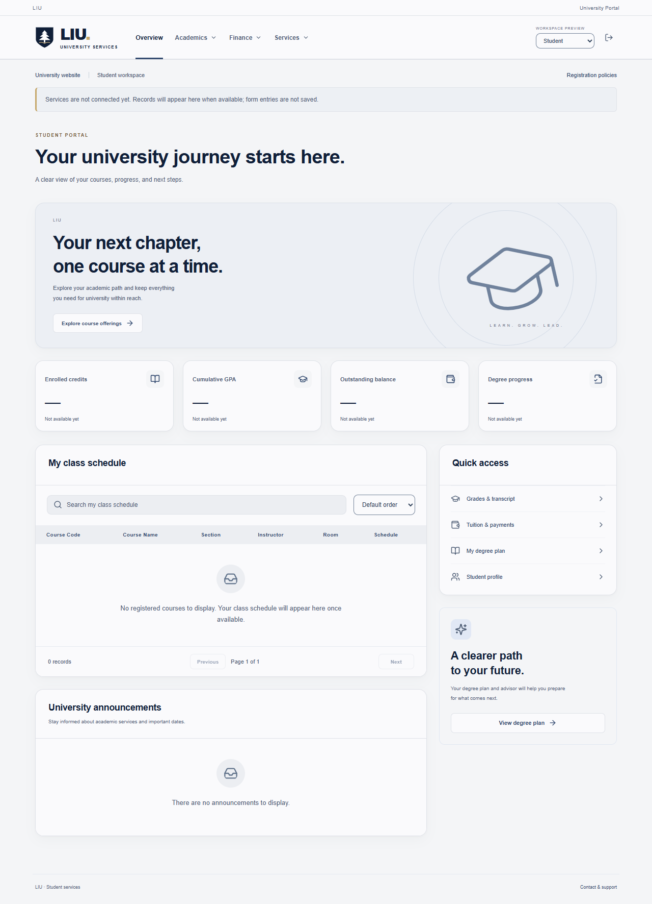
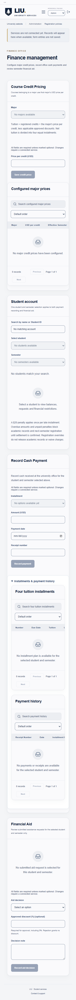

# ISD — CSCI426 Phase 1: University Registration Frontend

Phase 1 submission of an LIU-inspired university information and registration interface. The project combines a public academic guide with separate Student and Admin workspaces. It is an independent academic implementation, not an official university service.

Repository: [isd-csci426-phase1](https://github.com/danielmsadi/isd-csci426-phase1) (private; assessor access must be granted).

Live website: [isd-csci426-phase1.vercel.app](https://isd-csci426-phase1.vercel.app). Deployed to Vercel and verified without login cookies on desktop and mobile on November 13, 2026. Public routes and refreshes work; Student/Admin routes retain their existing production redirect to sign-in.

## Technologies and installation

React 19, React Router 7, Vite 6, JavaScript, CSS and Lucide React icons; Node.js built-in unit tests and Playwright browser tests. Use Node.js 22 or 24 LTS and npm. The lockfile is included for reproducible installation (`npm ci`); `npm install` is also supported. No environment variables are required for Phase 1. `.env.example` contains optional public API configuration only.

## Interface overview

| Interface | Features |
| --- | --- |
| Public | University guide, schools, searchable programs and course catalog, program academic plans, admissions checklist, tuition, campuses, contact and policies |
| Student | Dashboard, offerings, registration, schedule, grades, degree progress, finance, aid/major/override requests and read-only profile |
| Admin | Dashboard, student accounts, courses, sections, assessment configuration, grade management, academic calendar, finance and requests |

**Grading note:** run `npm run dev` to inspect the Student/Admin interfaces using the preview links on `/login`. The existing production behavior redirects these interfaces to sign-in because server authentication is not implemented. The deployed production site demonstrates public pages and authentication UI; it cannot sign users into the portals.

## UI screenshots

Screenshots show the existing frontend; Student/Admin images are development previews with empty records.





## Vercel deployment

The root `vercel.json` selects Vite, builds with `npm run build`, serves `dist`, and rewrites deep links to `index.html` so React Router can handle direct visits and refreshes. No backend or database is deployed.

1. Push this project to a **private** GitHub repository; make it public only after explicit owner approval.
2. Sign in to Vercel, choose **Add New → Project**, connect GitHub and grant access to that repository.
3. Import the repository with root directory `./`, framework **Vite**, build command `npm run build`, output directory `dist`, and Node.js 24.x. Leave environment variables unset for Phase 1.
4. Deploy, then open the generated URL. Check `/`, `/programs`, a program detail and `/login` on desktop and mobile; directly open and refresh these URLs. `/student` and `/admin` should redirect to `/login` in production.

Alternatively, authenticate with `npx vercel login`, then run `npx vercel --prod` in this folder. Do not call the deployment verified until its actual URL is accessible and tested. See [submission verification and authorization steps](docs/submission-status.md).

The current deployment was published with the CLI. Automatic deployments from GitHub are not connected yet: add GitHub under Vercel Account Settings → Authentication, then connect this repository in the Vercel project's Git settings or run `npx vercel git connect`.

Configuration follows [Vercel's Vite SPA documentation](https://vercel.com/docs/frameworks/frontend/vite).

React + Vite, JavaScript, React Router and regular CSS. Frontend only: there is no backend, database, authentication implementation, sample dataset, fake payment, email inbox or AI response.

## Run

```powershell
cd "C:\Users\user\Downloads\ISD PROJECT_files"
npm install
npm run dev
```

Open the address printed by Vite, normally http://localhost:5173. The homepage is the public university guide. Choose **Student portal**, then **Preview Student** or **Preview Admin**. Use the workspace selector to switch roles. No credentials or accounts are needed or created. For the presentation, use `npm run dev`; the production build intentionally has no authentication bypass.

## Public university guide

LIU-inspired public pages retain the original custom branding and navy/white design. Public copy contains no project/developer labels, citations or verification dates. Research and conflicts are documented internally. The directory contains 65 program entries and three Freshman pathways, with a separate searchable local course catalog. This remains an independent implementation, with no claim of official university endorsement.

Public facts in `src/data/university.js`, `src/data/publicPrograms.json` and `src/data/publicCurricula.json` never populate portal records. Academic information is stored locally, with internal routes instead of external PDF redirects. Missing fields display “Information not yet available.” `/sources` redirects to `/about` for compatibility. Photography is licensed illustrative stock with an original SVG fallback. Internal provenance and coverage: `docs/public-sources.md`, `docs/academic-completeness.md` and `docs/presentation-guide.md`.

## Empty-state behavior

- All record collections start empty. Student identity, semester, balances, GPA, rates and progress start absent, displayed as dashes or explanatory empty states.
- No academic data or passwords are stored in localStorage or sessionStorage. Data saved by the previous demo is ignored and never loaded. Existing browser storage is not deleted.
- Forms accept input and perform client validation. Without an API, attempts to submit report that nothing was saved or sent. Selectors requiring real records remain disabled until those records exist.
- Tables keep their headers, searches and filters. Create/edit dialogs, forms, file selection, navigation and responsive styling remain available.
- File selection is local to the form; it is not persisted or simulated as an upload. Actual multipart uploads require a connected service.
- Transcript and receipt downloads require server responses. Payments and the advisor remain unavailable until integrated.

## Production behavior

```powershell
npm run build
npm run preview
```

The temporary role switch and route bypass are gated by `import.meta.env.DEV` and are absent in production. Student and Admin URLs redirect to the sign-in page in a production build until server-backed authentication is implemented. The development switch grants no backend permissions.

## Structure

- `src/pages/`: public, Student/Admin and authentication pages.
- `src/components/`: reusable navigation, empty states, forms, tables and dialogs.
- `src/styles/`: responsive university visual system.
- `src/data/emptyPortal.js`: empty response shape and normalization.
- `src/data/api.js`: fetch adapter with explicit unavailable/error behavior.
- `src/data/PortalContext.jsx`: load state, server data and feedback; no record persistence.
- `src/App.jsx`: routes and development-only preview boundary.
- `docs/backend-integration.md`: proposed API contracts and integration steps.

The requested registration and finance policies remain unchanged and are documented at `/policies`; they must not be represented as official LIU policies. No backend/database code was created. The existing API adapter is unchanged; new frontend request shapes are documented in `docs/gradebook-integration.md`. Calculated Gradebook results are provisional until a connected service saves/publishes them. No student records or grades are seeded.

## Grade Management and student administration

`/admin/courses?view=assessments` supports adding, editing and removing assessment definitions, validates positive maxima and weights totaling 100%, and configures grade thresholds and rounding. The Grade Management page selects a semester/course/section, uses only actual enrolled students, validates scores, calculates percentages/letter grades/grade points, and supports draft/publication requests. Student grades show published records only; financial holds still block grades, GPA, assessment breakdowns and transcripts. Save attempts without services report errors rather than simulated success.

## Checks

```powershell
npm test
npm run test:e2e
npm run build
```

Browser tests use installed Microsoft Edge and launch dev and production-preview servers. To use Chrome, set `$env:PLAYWRIGHT_CHANNEL="chrome"` first. Tests verify empty pages, forms, navigation, mobile layout and absence of the production preview bypass. They do not create sample academic records.

The original saved-webpage files in the project root remain untouched.

## Latest presentation workflows

Grade Management uses one assessment-entry table with draft and publication actions. Course management owns assessment structures and grading rules. `/admin/gradebook` and `/admin/grades` redirect to Grade Management; `/admin/assessments` redirects to course configuration. Profile is read-only; Admin manages the shared student record. Academic Calendar retains `/admin/settings` and adds semester selection and a saved-date timeline. Finance retains `/admin/finance` with three forms: major credit pricing, cash payments and semester-specific financial aid. Payments and aid share one student/semester selection; registration overrides remain a compact account action. Undergraduate and graduate public tuition are separate, with system payment policies clearly distinguished from LIU fees.

Backup: `backups/frontend-20261112-132330.zip`. Field contracts and remaining integration requirements: `docs/management-update.md`. No backend/database was changed, and no student/grade/payment records were seeded.
